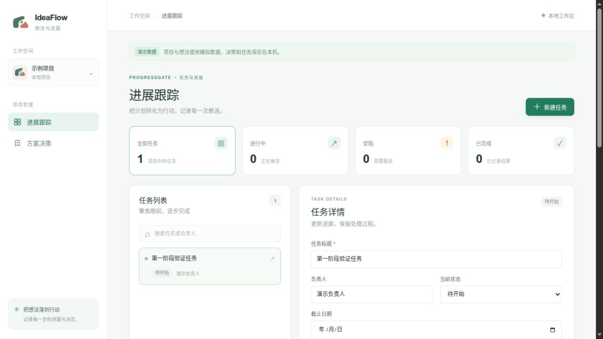

# ProgressGate 第一阶段验证记录

验证日期：2026 年 11 月 1 日。范围：唐逸飞负责的决策与任务跟踪模块。验证对象为本地个人分支及本次整理的工作区变更；分支于 11 月 2 日改名为 `dev-part4`。结果不代表其他模块的集成验证。

2026 年 11 月 2 日收尾复核：相同后端测试集再次得到 **5 passed，1 warning**（0.57 秒），前端 `npm run build` 再次通过（27 个模块，405 毫秒）。本次复核未扩展功能范围，也未将第三模块的静态检查当作测试通过。

## 环境与执行结果

- 后端：Python 3.12.14，pytest 9.2.0，使用模块已有虚拟环境。
- 前端：Node.js 22.23.1、npm 10.9.8、Vite 7.3.7，使用已有依赖和锁文件。
- 后端在 `progressgate/backend` 执行 `python -m pytest -q`，结果为 **5 passed，1 warning**。
- 前端在 `progressgate/frontend` 执行 `npm run build`，结果为 **构建通过**。
- `progressgate/design-preview/app.js` 使用 `node --check`，语法检查通过；这不等同于覆盖所有原型交互的自动测试。

本次受限执行环境中的后端测试在测试客户端启动线程通信处等待，限定时间后终止；随后在本机运行相同测试通过。此环境现象没有通过跳过用例或更改业务规则处理。

唯一警告来自测试客户端依赖：Starlette 提示其使用 `httpx` 的方式将被弃用，建议迁移到 `httpx2`。当前测试仍通过，本阶段未为消除提示而额外升级依赖。

## 自动测试覆盖

1. **决策到任务及阻塞恢复**：采纳想法后创建任务；检查 UUID、初始状态和日期；拒绝无原因的受阻及无结果的完成；验证阻塞、恢复、完成、历史记录和清空日期。
2. **手动任务与决策独立**：手动创建不依赖想法；修改决策沿用编号；未采纳的想法不能创建关联任务；改变决策不自动创建任务。
3. **模拟来源及无来源想法**：来源接口返回所属会话和上下文；手动想法返回空来源列表。
4. **非法输入及关联**：未知项目或任务、跨项目想法、空白标题和无效日期返回错误。
5. **重新打开数据库后读取**：在临时 SQLite 文件保存决策、任务和阻塞事件，关闭客户端、释放连接并建立新引擎与客户端后，再读取决策、任务和历史。该测试验证重新连接后的文件持久化，不冒充完整部署重启测试。

测试源码见 [test_progressgate.py](../../progressgate/backend/tests/test_progressgate.py)。每项自动测试使用隔离数据库，不修改用户的默认数据库。

## 浏览器基本验证

本次用构建后的实际 Vue 页面连接 FastAPI，数据库位于系统临时目录；没有使用默认 `progressgate.db`。

实际操作：打开进展跟踪页面，新建名为“第一阶段验证任务”的手动任务，填写演示负责人和完成条件；页面显示“任务已创建”；刷新后任务、负责人、完成条件和创建记录仍可读取。

同时目视检查功能页面中的产品标志和项目图标，均显示 S 方向的图形。该检查只验证标志显示及以上创建、刷新流程，不表示所有表单、响应式布局或浏览器已全面测试。

## 未覆盖与后续事项

- 尚未接入其他成员真实的项目、想法、会话和检索接口。
- 未进行多人并发、权限、部署、性能和跨浏览器测试。
- 未实现数据库版本迁移；自动建表不能代替迁移方案。
- 视觉原型和可保存数据的功能演示是两套实现；原型中的深浅模式及联动效果尚未完整移植为功能页面。

以上未完成事项保留在后续开发范围，不作为本阶段已通过的结果。

## 课程材料归档检查

立项报告从已有正式 DOCX 原样复制到 `docs/proposal/`，源文件与归档文件的 SHA-256 均为 `8558c3754ad55dd7af70ad36841c36a68e92ad257255c9a9c7e87b57ff6e20b8`；未改写报告、日期或其中的计划。微信目录中带“8组”和不带组号的两个文件内容完全相同；实际组号以组长 2026 年 11 月 2 日确认的第 7 组为准。

本次调用文档工具附带的 LibreOffice 渲染器复核原件，但其依赖的 `GLIBC_2.38` 和 `GLIBCXX_3.4.31` 在当前系统不可用，因此未完成本次版面渲染复核。该限制不影响字节一致的原件归档，不将其描述为重新排版或新报告已审定。未切换到用户桌面办公软件改写原件。
