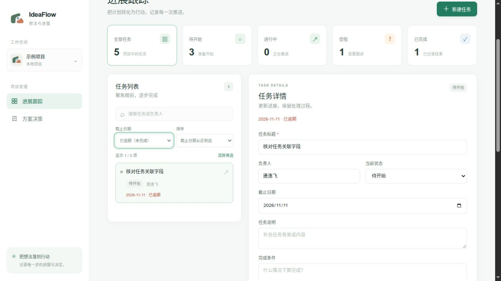

# ProgressGate 第三周验证记录

验证日期：2026 年 11 月 12 日。范围：唐逸飞负责的第四模块，本次任务列表改进与既有功能回归。

## 自动测试和构建

在 `progressgate/frontend` 运行 `npm test`：4 项通过；运行 `npm run build`：28 个模块，生产构建通过。环境为 Node.js 22.23.1，使用现有依赖和锁文件，没有引入新的测试依赖。

新增测试覆盖：

1. 截止日当天不算逾期，前一天截止且未完成的算逾期；已完成任务和没有日期的任务不报逾期，日期推进后判断更新。
2. “待开始”、日期类型及任务标题或负责人搜索可组合使用，允许出现空结果。
3. 截止日期升序排列，无日期的放最后；相同日期按创建时间及编号稳定排序，不改写原始任务数组。
4. 上海与洛杉矶跨 UTC 日界线时，取使用者本地日历日期，不使用 UTC 日期截断来判断逾期。

在 `progressgate/backend` 运行 `.venv/bin/python -m pytest -q`：7 项通过，1 条既有 Starlette 测试客户端使用 httpx 的弃用提示。后端本次没有修改数据结构和业务接口。测试在正常执行环境中完成；受限环境的前端测试子进程仅输出文件级结果，已在正常环境重新核对 4 个实际测试结果。

## 浏览器验证

使用本地实际 Vue 页面和 FastAPI 服务，数据库及验证脚本位于系统临时目录，没有修改默认数据库。准备 5 项模拟任务：昨日截止的待开始任务、今日截止的受阻任务、过去截止且已完成的任务、未来截止的待开始任务，以及没有截止日期的任务。

- 选择“待开始”和“已逾期（未完成）”后，只显示昨日截止的任务。
- 清除筛选并按截止日期排序，列表按日期从近到远排列，无日期的任务在最后；已完成的历史任务保留原日期且不显示逾期标记。
- 将第一项任务的历史响应人为延迟 1.5 秒，快速切换至第二项任务；第二项自己的“下一步”变更仍然保留，第一项的迟到响应没有覆盖它。
- 将逾期任务改为“已完成”并填写执行结果，页面显示保存成功、已完成数量增加，逾期筛选中不再显示该任务。

下图为临时数据下的逾期筛选画面，截图中的任务用于验证，不是个人或全组实际任务的完成状态。

## 验证边界

本次验证覆盖本地日期计算、列表操作和上述保存、历史切换场景。未覆盖跨模块真实数据联调、多用户并发、性能压测或全部浏览器和屏幕尺寸。定时跨日刷新已有实现，未通过长时间等待到真实午夜进行验证；日期计算边界由自动测试覆盖。
