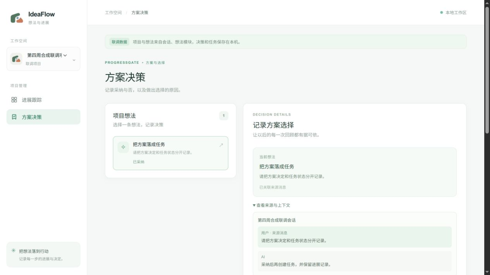

# ProgressGate 第四周联调验证记录

日期：2026 年 11 月 19 日。对象：第四模块 `dev-part4` 的服务接入功能。验证使用合成会话及临时数据库，没有使用真实私密会话或修改成员默认数据库。

## 自动验证

- 第四模块后端：在 `progressgate/backend` 运行 `.venv/bin/python -m pytest -q`，19 项通过，1 条既有 Starlette/httpx 测试依赖弃用提示。
- 前端：`npm test`，4 项通过；`npm run build`，28 个模块，生产构建通过。
- 既有测试继续覆盖决策历史、旧数据库添加历史表、任务受阻与恢复、持久化及非法关联。
- 新增测试覆盖真实输入模式下的项目过滤及字段映射、显式采纳、完整来源、缺坐标、非法坐标、跨项目来源、已删除会话或消息、服务断线和格式异常、想法移项目后的重新确认，以及错误配置不能变成模拟模式。

服务接入自动测试使用受控 HTTP 响应，验证错误与边界行为；以下真实服务验证另行执行，二者不混为同一种验证。

## 实际服务间验证

从已获取的正式分支提取源码到临时目录，分别运行独立进程：第一模块 `origin/dev-part1` 的 `7b07c58`，第三模块 `origin/dev-part3` 的 `5195025`；第四模块使用本次工作区代码。第一、第三模块源码保持原样，测试目录及数据库不纳入 Git。

本次第一模块监听 `18001`，第三模块监听 `18003`；第四模块监听 `8000`，`PROGRESSGATE_REFERENCE_MODE=live`，两个来源地址分别指向上述服务。第四模块使用临时 SQLite 文件。运行：

```bash
python scripts/check_progressgate_live.py --projects-url http://127.0.0.1:18001 --ideas-url http://127.0.0.1:18003
```

最终结果 `passed: true`。脚本验证了：

1. 在第一模块创建项目并导入两条合成消息，取得项目、会话、消息 UUID。
2. 在第三模块创建同项目的想法，写入包含同一项目、会话和消息编号的 `source_ref`，出处创建成功状态码为 `201`。
3. 第四模块读取到该想法及摘要；未采纳创建关联任务被拒绝，显式采纳后创建成功。
4. 无阻塞原因的受阻、无执行结果的完成被拒绝；正常受阻、恢复、完成后保存了 4 条任务事件。
5. 从第四模块来源接口读取到第一模块的原始消息，消息编号与导入响应一致，内容与导入内容一致。

这条流程没有运行第二模块，也没有验证检索召回、索引更新或片段级高亮。

## 浏览器

实际 Vue 页面连接第四模块联调服务。确认页面显示“联调数据”、实际想法摘要和采纳记录；展开来源后显示第一模块返回的会话与两条消息。从关联任务进入任务详情，状态为已完成，保留阻塞原因、处理结果和历史；切换至另一个项目后，不再显示该任务。



## 未覆盖

没有修改或验收其他成员的全部功能，没有完成四模块完整网页流程、跨浏览器与全部屏幕尺寸验证、长期并发、部署与权限验收。第三模块出处坐标可为空，第四模块会提示需补齐；第一模块覆盖导入产生新编号后的旧出处，按失效来源处理，自动重连和跨版本消息映射尚未实现。
