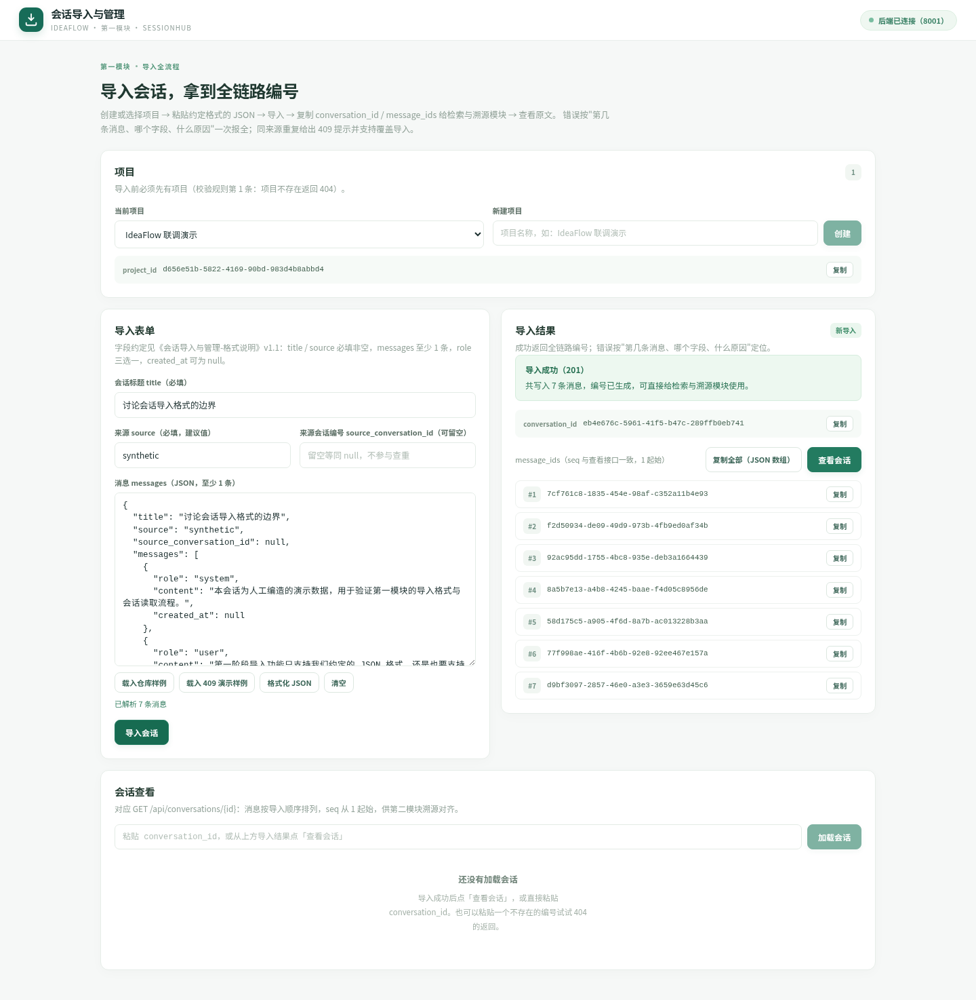
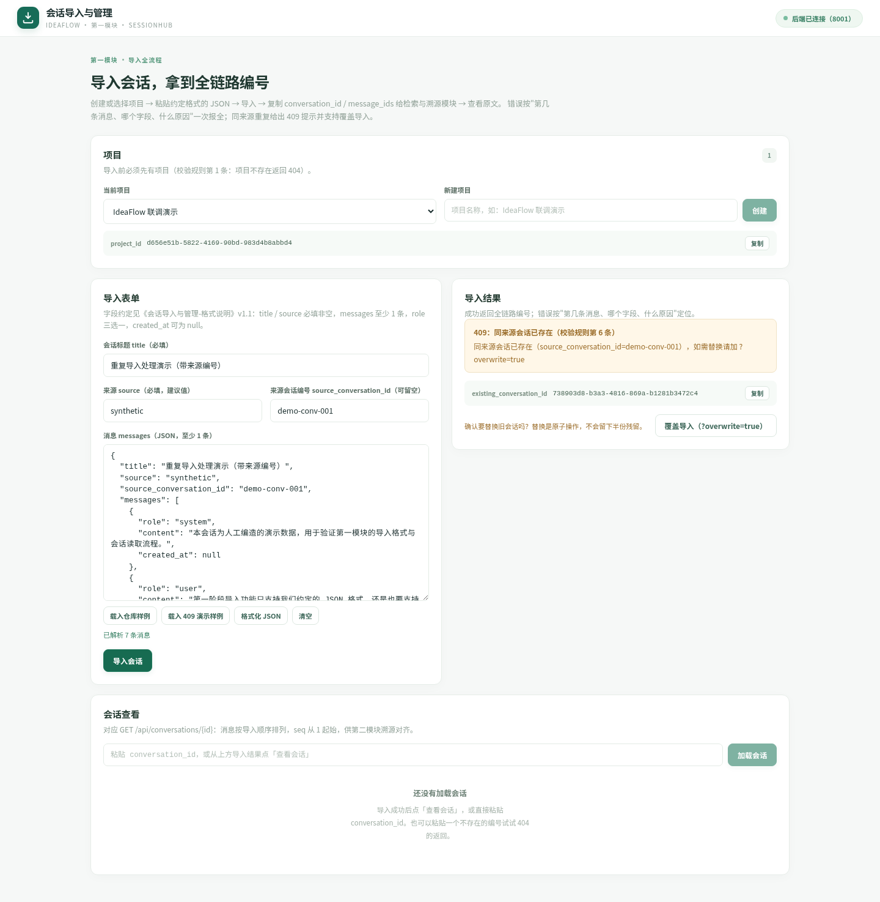
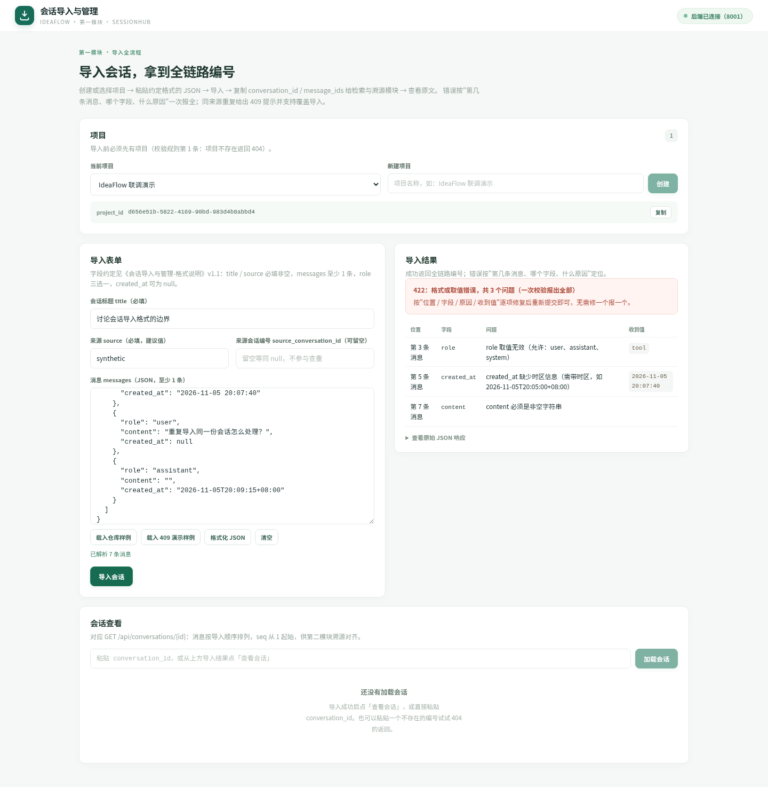

# 会话导入 —— 导入页面验证记录

日期：2026 年 11 月 22 日。对象：第一模块前端页面 `sessionhub/frontend/`（Vue 3 + Vite，与第四模块同栈）。
说明：页面实现、验证与本文由 AI 辅助完成并整理（对齐组内"AI 辅助实现、验证及整理须如实记录"的惯例）；验证环境为 Linux 沙箱（Node v24.22.2、Chromium 无头浏览器），Windows 本机按 README 步骤复验一遍后即可视为本机通过。

## 自动验证

- 前端单测：`npm test`（node --test），10 项纯逻辑用例全部通过。覆盖：错误归一化（422 数组 / 404、409 字符串 / 无 payload 的未知响应）、409 的 `existing_conversation_id` 提取、错误表排序（整体问题在前、消息级按序号升序）与"第 N 条消息"文案、`received` 缺失与非字符串的截断兜底、导入请求体组装（仅 messages 数组与完整请求体两种输入、来源编号留空不带字段、null 不参与查重）、messages 条数解析、完整请求体反填表单字段。
- 生产构建：`npm run build` 通过（Vite 7，18 个模块转换，JS 产物约 91 KB）。
- 后端回归：后端代码本次**未改动**；在含 `docs/样例/` 的仓库布局下 `python -m pytest tests/ -q` 20 项全部通过。

## 浏览器全流程实测

vite dev（127.0.0.1:5171，`/api` 代理到 8001）+ uvicorn（8001，`SESSIONHUB_DB` 指向临时数据库），Chromium 按以下顺序实际操作，8 项断言全部通过，无页面脚本错误：

1. 打开页面：顶栏点亮"后端已连接（8001）"；导入表单自动载入仓库样例原文并显示"已解析 7 条消息"。
2. 创建项目"IdeaFlow 联调演示"：`201` 返回 `project_id`，自动选中并显示可复制的编号行。
3. 导入仓库样例：成功面板显示 `conversation_id`、7 条 `message_ids`（带 seq 序号与复制按钮）、"复制全部（JSON 数组）"与"查看会话"按钮、"新导入"徽章。
4. 点击"查看会话"：7 条消息按 seq 排列，role 徽章区分 user/assistant/system，`created_at` 为 null 的消息显示"（原始记录没有时间）"，每条 `message_id` 可复制。
5. 载入 409 演示样例（`source_conversation_id=demo-conv-001`）首次导入返回 `201`；**再次**导入同内容返回 `409`，面板附 `existing_conversation_id`（可复制）与"覆盖导入"按钮。
6. 确认弹窗后重发 `?overwrite=true`：导入成功，徽章变为"已覆盖旧会话"。
7. 构造三类错误（第 3 条 `role:"tool"`、第 5 条 `created_at` 缺时区、第 7 条 `content` 为空）后导入：422 表格**一次报出 3 行**，位置/字段/问题/收到值与后端返回一致；"查看原始 JSON 响应"可展开。
8. 会话查看器粘贴不存在的编号：显示 404"会话不存在：…"，与后端返回一致。

截图（与本记录同目录）：

## 边界与说明

- messages 编辑区支持两种输入：完整请求体对象（以其中 `title` / `source` / `source_conversation_id` 为准，null 视为不查重）或仅 messages 数组（用表单字段组装）；前端只在本地做 JSON 语法预检（不合法时禁止发送并提示），格式与语义校验以后端 422 为准，前端不重复实现规则 1-6。
- 409 的"覆盖导入"在前端有确认弹窗（说明会删除旧会话），后端 `?overwrite=true` 的原子替换语义不变。
- 覆盖导入后旧 `conversation_id` 失效：页面以"已覆盖旧会话"徽章提示；对旧编号调用查看接口会得到 404，与后端行为一致。第三模块旧出处指向被覆盖会话时的失效处理，已在组长第四周验证记录中按"失效来源"处理，本模块页面如实透传 404，不做自动重连。
- 页面不包含会话列表（后端当前未提供列表接口，README 待办里已记录）；也不做消息编辑——消息只由导入产生（格式说明第 6 节边界）。
- 视觉对齐第四模块 ProgressGate（米白底、白卡片、墨绿主色、Noto Sans SC），便于组长统一入口时拼页。

## Windows 本机复验清单（负责人勾选）

- [ ] 安装 Node.js LTS（`node -v` ≥ 20.19）
- [ ] `cd sessionhub/frontend && npm install && npm run dev`，浏览器打开 127.0.0.1:5171
- [ ] 按"浏览器全流程实测"第 1-8 步走一遍，现象一致
- [ ] `npm test` 10 项通过；`cd sessionhub/backend && python -m pytest tests/ -q` 20 项通过
